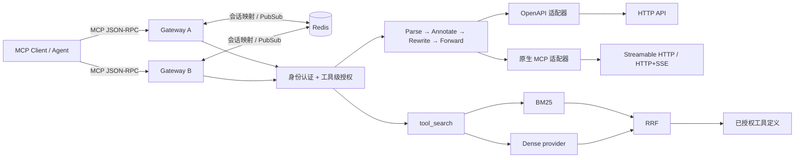

# 架构、协议边界与安全模型

## 1. 设计目标

本项目根据 *Scaling LLM Agent Tool Access: The MCP Gateway*（Li et al., SIGOPS ATC 2026，DOI: [10.1145/3828523.3857007](https://doi.org/10.1145/3828523.3857007)）实现一个可本地运行、可测试的 Python 参考网关。目标是复现可观察的核心机制，而不是复刻阿里云专有 L7 平台、Go/WASM 实现或生产实验结果。



图中的两个网关共享会话协调存储；工具目录与策略通过相同配置部署，不是通过 Redis 自动分发。Redis 不是通用 API 响应缓存，也不承诺把有副作用的工具调用变成 exactly-once。

## 2. 请求生命周期

1. **入口与身份**：检查入口凭证，建立主体身份，再处理 MCP 消息。客户端凭证不能未经明确配置直接传递给后端。
2. **Parse（解析）**：验证 JSON-RPC 消息、方法、工具名称和参数形状。协议错误和工具执行失败必须区别处理。
3. **Annotate（标注）**：根据已编译工具目录选择后端、传输方式及授权策略。后端 URL 由受信任管理员配置，不由工具调用者任意指定。
4. **Rewrite（改写）**：将工具参数映射为 OpenAPI 的 path/query/header/body，或者保留原生 MCP `tools/call` 结构；前后端 session ID 独立维护。
5. **Forward（转发）**：复用连接、应用超时和后端凭证，收到结果后转换为 MCP 工具返回结构。
6. **清理**：关闭客户端会话时清理相关会话状态和持有的通道；进程退出时关闭连接与协调资源。异常不应导致跨用户结果泄露。

### 2.1 OpenAPI 编译而非临时猜测

每个受支持的 OpenAPI operation 对应一个工具。工具的参数 Schema 来自规范，安装时应尽早拒绝不支持或有歧义的输入。运行时负责参数验证与位置映射，而非使用 LLM 猜测 HTTP 请求。

支持范围以 [论文映射与差距](paper-traceability.md) 和测试为准。OpenAPI 文档不等于运行任意 URL 的授权；规范与后端凭证均是可信管理面输入。回调、任意文件上传、任意认证流程、全部 OpenAPI 序列化组合不在默认能力声明中。

### 2.2 工具发现与授权

工具推荐作为普通 MCP 元工具提供，不改变 `tools/list` 的标准语义。检索返回工具定义，之后仍必须走标准调用路径；“被推荐”不等于“被授权”。工具列表、搜索和调用均应受同一主体的工具权限限制。

当前实现**没有查询结果缓存**：候选集合和 BM25 语料统计都先按授权范围过滤。若将来加入缓存，租户/主体、可见目录、检索参数、目录版本等必须进入缓存隔离条件；缓存命中不能绕过授权。

## 3. 检索与论文扩展项

论文 §4.3 的基本配置为：每路候选数 `L=120`；BM25 `k1=1.2, b=0.75`；RRF 平滑常量 `20`；dense 路使用余弦相似度。索引字段为名称、描述与顶层参数名称；词法侧拆分 camelCase，并处理停用词。

对候选工具 `t` 的融合分数为：

```text
RRF(t) = Σ_{path ∈ {dense, sparse}, t ∈ path} 1 / (20 + rank_path(t))
```

排名从 1 开始。先分别排序，再对候选并集融合；不能把 cosine 与 BM25 原始分数直接相加当作论文算法。

- **离线默认 provider**：可复现、无需下载模型的确定性向量用于验证管线。它不是论文的预训练语义编码器，不能据此声称具有同等同义改写能力或达到论文召回率。
- **真实 dense provider**：若启用外部/预训练编码器，模型版本、维数、语料、候选集合、延迟和授权边界都应另外评测；不应静默退回离线 provider 后继续宣称使用该模型。
- **知识缓存（未实现）**：论文 §7 描述的工具依赖 DAG、拓扑展开与前置工具补全不包含在当前版本。
- **语义 LRU 缓存（未实现）**：当前版本无查询结果缓存，更不声称复现论文缓存加速；LRU 淘汰与语义相似度命中是不同机制。
- **查询改写（未实现）**：当前版本不含论文 §7 的 RE-Agent/Rewrite-Agent 流程，也不进行隐式 LLM 查询改写。

## 4. 会话、亲和性与长连接

### 4.1 两级标识

客户端只看到 frontend session ID。网关在后端首次使用时建立 backend session，并在共享存储中关联：

```text
frontend session + service → backend session + stable routing hash + owner metadata
```

具体字段由实现决定。不同网关实例必须读取一致映射，不能为每次请求创建新 backend session。`Routing-Hash` 应是稳定派生值，而非直接把客户端原始 session ID 透传到后端服务边界。

本项目输出稳定 Routing-Hash，并通过测试验证后端收到同一值；这不代表已经部署了论文中独立扩缩容的服务层一致性哈希环。

### 4.2 HTTP+SSE 与 Streamable HTTP 不同

- **Streamable HTTP**：接收请求的网关从共享映射取得 backend session ID、协商协议版本与 Routing-Hash，直接向后端发送请求并返回响应；不要求最初初始化该后端会话的网关继续存活。后端的 JSON 与请求级 SSE 回应均按请求 ID 关联。
- **前端 legacy SSE**：SSE 流由一个网关实例持有。POST 请求落到另一实例时，需通过共享协调层把消息/结果送到正确的流持有者。
- **后端 legacy SSE**：后端流的持有者与前端 HTTP 请求的处理者可能不同，必须进行跨实例响应关联。

Redis Pub/Sub 是瞬时消息通知而非持久队列：订阅前或断线期间的消息可能丢失。请求关联、超时和资源清理要由网关处理。它不提供跨进程崩溃的 exactly-once 工具执行保证；不要自动重试可能已执行的有副作用调用。

### 4.3 故障边界

失去持有 legacy SSE 长连接的进程，并不保证原 TCP/SSE 通道无损迁移；该路径失败后需要新建会话。Streamable HTTP 路径可以在最初初始化网关退出后由其他实例继续使用共享 backend session，但前提是后端本身的会话仍然有效。共享映射不会凭空恢复已经丢失的后端内存状态。Redis 故障、session 过期、后端返回 session 无效、owner 不可达应产生可诊断失败或显式重建流程，不能伪造成功。

## 5. 部署与安全边界

- 示例凭证只适用于本地演示。公开暴露服务前必须更换凭证，使用 HTTPS，限制入口、Redis 和后端的网络访问。
- Redis 含有会话元数据且承载跨实例协调，不应直接公开到互联网。生产 Redis 需要认证、TLS、容量限制和高可用设计。
- 配置内的后端 URL 与 OpenAPI 规范按可信管理输入处理；本项目不把它们视为可安全接受不可信用户输入的 SSRF 防护沙箱。
- 日志不应输出 bearer token、后端密码或未经处理的敏感工具参数。示例故障响应应控制细节，不直接回显秘密。
- 网关是持有后端凭证的信任边界；最小权限、凭证轮换、审计、OAuth 委托和策略治理仍需部署方负责。
- 本项目不包含生产 WAF、完整 OAuth/OIDC 身份系统、多区域容灾、分布式限流或对所有 MCP 版本的符合性认证。
